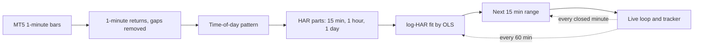

# ⚡ HAR-RV Scalping Forecaster for MetaTrader 5

  

A Jupyter notebook (`HAR_RV_SCALP_MT5.ipynb`) that reads **1-minute bars from your MT5 demo account** and, every minute, forecasts **how far price can move in the next 15 minutes**. It shows the forecast as a 68% and a 95% price range, live.

> **It forecasts the SIZE of the next move, not the DIRECTION.** Use it for stop distance, take-profit distance, position size, and deciding when the market is worth scalping. It is not a buy/sell signal.

---

## 🧠 Recall in 60 seconds

Click any line to open the full explanation.

<b>Realized volatility (RV)</b> — one number for "how much did price move", built from many small moves

Add up the squared 1-minute log returns over a window. Over 15 minutes, that is 15 squared returns added together. Its square root is the typical size of the move in that window. It is much sharper than looking at one return, because it sees every swing.

<b>HAR-RV</b> — Heterogeneous AutoRegressive model of Realized Volatility

Forecast = constant + weight × (last 15 minutes) + weight × (last hour) + weight × (last day).
Three windows stand for three kinds of traders: scalpers, intraday traders, and slower money. Together they copy the long, slowly fading memory of volatility. It is fitted with plain **OLS regression**, so it never fails to converge.

<b>Time-of-day pattern</b> — the market is quiet at some hours and wild at others

Gold, NQ and BTC are calm in the Asian night and very busy around the US open (on NQ, the busiest 15 minutes were about 6x an average minute). The model **takes this pattern out** before fitting and **puts it back** into every forecast. This is the single biggest improvement over GARCH(1,1), which does not know the clock.

<b>Log-HAR</b> — fit on log(volatility) instead of volatility

Minute data has spikes. Working in logs keeps forecasts positive and stops one spike from pulling the whole fit. A small "smearing" correction undoes the log when converting back.

<b>Range widths from real moves</b> — not from a textbook bell curve

After fitting, the model checks how big the real 15-minute moves were compared with its forecasts. The 68% and 95% widths come from those real moves, so the ranges include gold's fat tails. On NQ the 95% range came out at ±1.94 sigma.

<b>Walk-forward test</b> — the only honest test

Fit on the past only, forecast the next day, score it, move forward one day, repeat. The model never sees the day it is scored on. Step 4 does this on your own symbol.

<b>QLIKE</b> — the score for volatility forecasts (lower = better)

It punishes forecasting too LOW more than forecasting too high. That matches the risk: being caught by a wild move you called calm costs more than the opposite.

<b>Coverage</b> — does the range keep its promise?

A 95% range should contain the real move about 95% of the time, in every session. Much lower = ranges too tight (stops get hit). Much higher = ranges too wide (wasted distance).

---

## 📊 Does it work? (tested on real NQ 1-minute data, 60 days, walk-forward)

| Model | Score, next 15 min (QLIKE, lower = better) | Score, next 5 min | How closely it tracks real moves (15 min) |
|---|---|---|---|
| **HAR + time of day (this notebook)** | **0.229** | **0.423** | **0.82** |
| HAR without time of day | 0.309 | 0.476 | 0.75 |
| GARCH(1,1) on 1-minute bars | 0.311 | 0.472 | 0.75 |
| "Next 15 min = last 15 min" | 0.450 | 1.090 | 0.73 |

95% range coverage by session (next 15 minutes, target 95% everywhere):

| | Asia 00–07 | Europe 07–13 | US 13–20 | Late 20–24 |
|---|---|---|---|---|
| **HAR + time of day** | 96% | 96% | 95% | 96% |
| GARCH(1,1) on 1-min | 96% | 96% | **94%** (too tight at the open) | **97%** (too wide at night) |

Session hours are broker time (UTC). These results are for NQ. **Run Step 4 on your own symbol before trusting it.**

---

## 🚀 Quick start

1. **Open MT5**, log in to your demo account, and wait until prices are ticking.
2. **Open `HAR_RV_SCALP_MT5.ipynb`** (Windows, Python 3.10 or newer).
3. In the **Config** cell, set `MT5_SYMBOL` exactly as in **Market Watch** (`XAUUSDm`, `BTCUSDm`, ...).
4. **Run the cells top to bottom.** The last one runs live. Stop it with **■**.

---

## 🧩 The cells, in order

<b>Cell 1 — Install</b>

**Starts with:** `%pip install -q MetaTrader5 statsmodels arch matplotlib`
**Do:** run once, restart the kernel if asked.

<b>Cell 2 — Config</b> ✏️ the only cell you edit

**Starts with:** `#  CONFIG  - the ONLY cell you need to edit`

| Setting | What it does | Default | When to change it |
|---|---|---|---|
| `MT5_SYMBOL` | symbol, exactly as in Market Watch | `"XAUUSDm"` | always check it |
| `HORIZON_MIN` | forecast the next N minutes | `15` | 5 for very fast scalps, 30 for slower trades |
| `TRAIN_DAYS` | days of 1-minute bars used to fit | `20` | 15–30; fewer reacts faster, more is steadier |
| `TEST_DAYS` | days scored in Step 4 | `10` | more = a firmer verdict, but needs more history |
| `POLL_SECONDS` | live screen refresh | `5` | rarely |
| `REFIT_EVERY_MIN` | refit the model every N minutes | `60` | rarely |
| `LOG_ROWS` | rows in the live table | `10` | taste |

The "fixed design" lines below them (15 min / 1 hour / 1 day windows, 15-minute time slots) don't need changing.

<b>Cell 3 — Helpers</b>

**Starts with:** `#  Helper functions (run once, nothing to edit)`
**Do:** run it. It holds the MT5 connection, the time-of-day pattern, the HAR model and the GARCH comparison.

<b>Cell 4 — Step 1: Load history</b>

**Starts with:** `# STEP 1: LOAD 1-MINUTE HISTORY FROM MT5`
**Expect:** the number of bars, the date range, and `Full trading days: N`.
**Check:** N should be at least `TRAIN_DAYS + TEST_DAYS` (30 by default). If it says "Not enough history", see Troubleshooting.

<b>Cell 5 — Step 2: Time-of-day pattern</b>

**Starts with:** `# STEP 2: THE TIME-OF-DAY PATTERN`
**Expect:** a bar chart of how busy each 15 minutes of the day is (1.0 = average minute), with broker time and IST on the axis, plus the busiest and quietest slots.
**Read it:** the tall bars are when ranges will be wide. A near-empty slot is usually the broker's daily break.

<b>Cell 6 — Step 3: Fit the model</b>

**Starts with:** `# STEP 3: FIT THE INTRADAY HAR-RV MODEL`
**Expect:** a table of the three weights (last 15 min, last hour, last day) with t-stats, the persistence (sum of weights), the 68% and 95% widths, and a first forecast.
**Read it:** t-stats above about 2 mean that part really matters. On NQ the last hour carried the most weight (0.45).

<b>Cell 7 — Step 4: Walk-forward test</b> ⭐ the most important cell

**Starts with:** `# STEP 4: WALK-FORWARD TEST ON YOUR DATA`
**Expect:** two tables. The first ranks four forecasters by QLIKE. The second shows 95% coverage by session.
**Read it:**
- The top row is the best forecaster **on your symbol**. If it is not "HAR + time of day", tell me what you see.
- Coverage should be close to 95% in **every** session, not just overall.

<b>Cell 8 — 🔴 LIVE loop</b>

**Starts with:** `#  MT5: LIVE loop - intraday HAR-RV for scalping`
**Do:** run it and leave it running. **Stop with ■.** It never ends on its own.

**The chart:** last 2 hours of price, then a cone for the next 15 minutes: dark blue = 68% range, light blue = 95% range, green dot = live price.

**The text below it:**

| Line | Meaning |
|---|---|
| `LIVE price ... spread` | mid of bid/ask, and the current spread |
| `Spread check` | the spread as a % of a typical 15-minute move. The higher it is, the more of each move the spread eats |
| `Next 15 min ... 68% range ... 95% range` | the forecast, starting from the last closed price |
| `Time of day` | how busy the next 15 minutes usually are vs an average minute |
| `Market now` | the last 15 minutes vs what is normal for this time: **ACTIVE** above 1.5x, **CALM** below 0.67x |
| `Tracker` | 15 minutes after each forecast: did the real move stay inside the 68% / 95% range? |
| Table → `Result` | `inside 68%`, `inside 95%`, `OUTSIDE 95%`, or `pending` |

---

## ✅ Checklist for accurate analysis

Tick these off (in your own copy of this file) before you rely on the numbers:

- [ ] **Use enough history.** Step 1 should show at least 30 full trading days.
- [ ] **Run Step 4 on the exact symbol you trade.** Results on NQ don't prove anything for gold or BTC.
- [ ] **Check coverage in every session**, not just the overall number. 93–97% is fine. Below 90% in a session = ranges too tight there.
- [ ] **Check your broker's clock.** IST times assume broker time = UTC (true for your Exness server). If your broker differs, change `to_ist` in the Helpers cell.
- [ ] **Watch the tracker for at least a day** before using the ranges for stops. It should drift toward 68% and 95%.
- [ ] **Look at the spread check.** If the spread is a large share of the 15-minute move, scalping that symbol is mostly paying the spread.
- [ ] **Be careful around scheduled news** (US CPI, NFP, FOMC). The model learns from past minutes; it cannot see a news release coming. Ranges will usually be too tight in the first minutes after news.
- [ ] **Keep the laptop awake and MT5 open.** If the loop pauses, forecasts across the pause are skipped, not scored.
- [ ] **Re-run Step 4 every week or two.** Markets change; the verdict can too.
- [ ] **Paper-trade on demo first.** Treat the ranges as risk guides, never as entry signals.

---

## 🛠️ Troubleshooting

Click to open

| Problem | Fix |
|---|---|
| `ModuleNotFoundError: MetaTrader5` | run Cell 1; Windows only; try Python 3.12 if no wheel |
| `MT5 initialize failed` | open MT5, log in, wait for ticking prices, run again |
| `Symbol '...' not found` | copy the exact name from Market Watch |
| "Not enough history" in Step 1 | lower `TRAIN_DAYS` / `TEST_DAYS`, or raise **Tools → Options → Charts → Max bars in chart** in MT5 (the default settings need about 47,000 one-minute bars) |
| `NameError: ... is not defined` | a cell above was skipped: run from Cell 2 down |
| A cell shows `[*]` forever | the live loop is still running; press **■** |
| `no new bar for over 3 minutes` | market closed or feed paused (weekend, daily break) |
| Tracker far below 95% for a day | ranges too tight for current conditions: re-run Step 4; avoid news times |

---

📚 **Theory:** [Corsi (2009), *A Simple Approximate Long-Memory Model of Realized Volatility*](https://ideas.repec.org/a/oup/jfinec/v7y2009i2p174-196.html), the paper behind HAR-RV.

⚠️ **Educational use only. Not financial advice.** Test on a demo account. A volatility range does not predict direction, and trading carries risk of loss.
